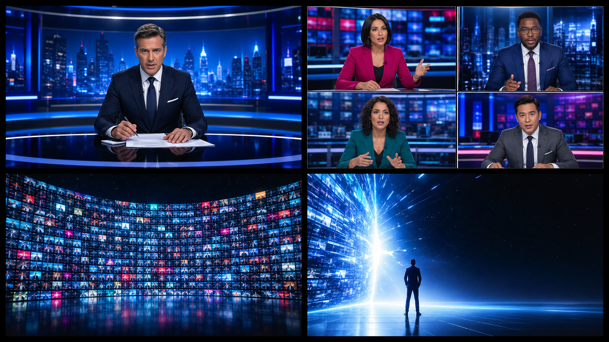
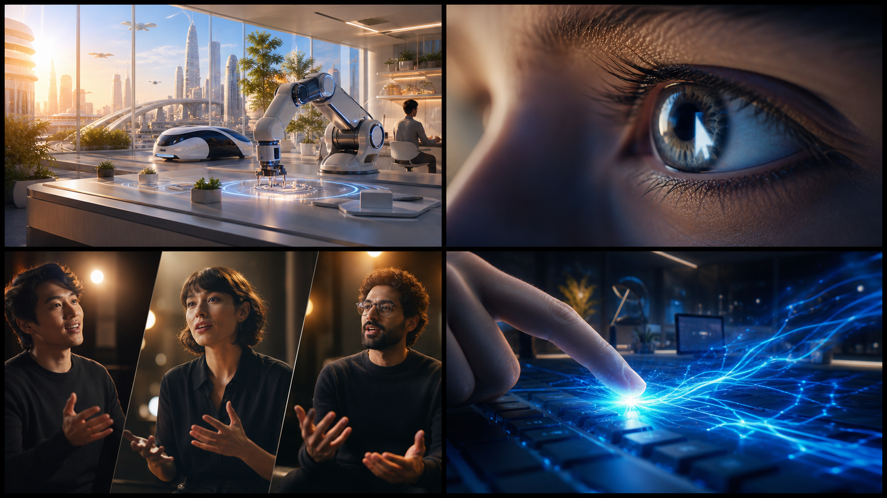
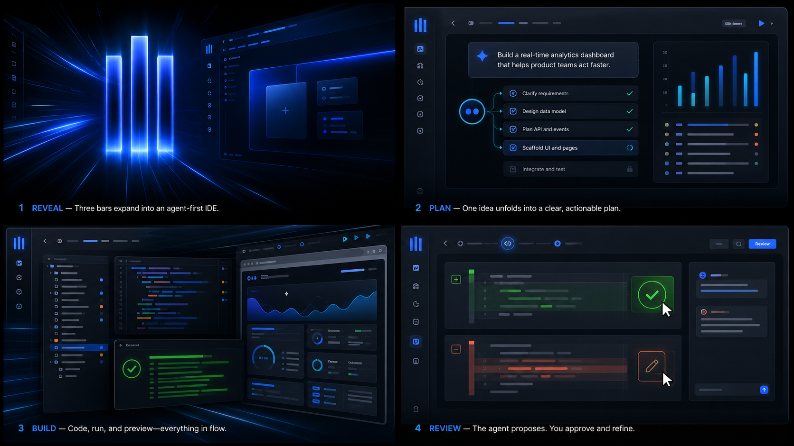
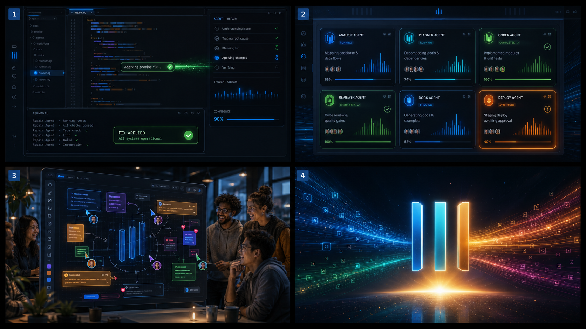

# Backboard — “What Will You Build?” Visual Storyboard

## Direction

- **Runtime:** 90 seconds
- **Energy:** fast, bright, optimistic, and increasingly celebratory
- **Visual arc:** electric broadcast urgency → sunrise curiosity → cobalt building momentum → full-color creator celebration
- **Image rule:** every storyboard image is newly generated concept art. **No image or screenshot of the real Backboard app is used.**
- **Panel order:** every sheet reads top-left → top-right → bottom-left → bottom-right.
- **Music:** original 112 BPM future-pop/electronic track for the main launch section; crisp drums, bright synth plucks, warm bass, no vocals

The opening is urgent, but it should feel like the exciting first ten seconds of a championship broadcast—not depressing or apocalyptic. The film becomes openly hopeful at 00:15 and stays upbeat through the finish.

## Sheet 1 — The news crescendo

| Time | Panel | What happens | Dialogue / copy | Sound and music |
| --- | --- | --- | --- | --- |
| **00:00.000–00:03.500** | 1 — Single anchor | Six black frames, then a narrow CRT ignition opens onto one fictional reporter. Start in a centered medium shot and push in 2%. Saturated midnight blue and bright studio white keep the shot energetic. | Reporter: **“AI is taking over the world. Everyone will lose their jobs.”** | Dry broadcast voice, small CRT click, subtle newsroom hum. No music yet, so the opening lands clearly. |
| **00:03.500–00:06.200** | 2 — Four anchors | The frame splits 1 → 2 → 4. Every anchor, wardrobe, and set is different. Cuts land directly on words, with magenta, cyan, teal, and cobalt alternating across the grid. | Overlapping: **“Artificial intelligence is coming for your job.” “No industry is safe.” “The machines don’t sleep.”** | Bright 120 BPM tension pulse begins, with one crisp relay click per split. Voices pan to their tiles. |
| **00:06.200–00:11.800** | 3 — Hundreds | Four anchors become 16, 64, 144, then **216**. The camera accelerates backward until the feeds form a spectacular curved wall. Avoid making every broadcast readable; color and movement are the point. | Fragments: **“Replaced—” “Faster than expected—” “Millions at risk—” “What happens next?”** All voices hit **“jobs”** together at 00:10.900. | Layer ticking percussion, shutters, notification chirps, printer chatter, and a rising synth. Keep the rhythm musical instead of abrasive. |
| **00:11.800–00:15.200** | 4 — Power cut | Giant copy briefly covers the wall: **EVERYONE WILL LOSE THEIR JOBS.** At 00:13.967, every screen collapses into one bright electric-blue seam. Cut to black for 36 frames. | No new dialogue. | Fast digital tear and short sub hit, then absolute silence. The blue burst should feel like a launch ignition, not destruction. |

## Sheet 2 — The human choice

| Time | Panel | What happens | Dialogue / copy | Sound and music |
| --- | --- | --- | --- | --- |
| **00:15.200–00:20.800** | 1 — Automated world | Sunrise floods a clean near-future space. An elegant robot arm works beside a human; autonomous mobility passes outside. Everything looks abundant, calm, and genuinely desirable. | VO: **“In a world where everything is done for you…”** | Felt piano C3 → G3, gentle servo movement, passing tire wash, warm room tone. This is the emotional turn toward optimism. |
| **00:20.800–00:23.500** | 2 — Human eye | Extreme close-up of a human eye reflecting one bright cursor. Match cut from the cursor reflection to a real insertion point on black. It blinks twice. | VO: **“…what will you do?”** On-screen: **WHAT WILL YOU DO?** | One inhale, soft cloth movement, and a key-down. A confident 90 BPM pulse enters three frames before the founder montage. |
| **00:23.500–00:37.800** | 3 — Founder proof | Three warm, editorial founder clips play as individual full-screen shots, not a simultaneous triptych in the final edit. Use Jensen Huang first, Sam Altman second, Dylan Field third. The generated panel is composition-only; production uses cleared source footage. | **00:23.500 Jensen:** “You’re not going to lose your job to AI. You’re going to lose your job to somebody who uses AI.” **00:29.100 Sam:** “Let’s at least say it’s the best time yet. Hopefully there’ll be even better times in the future.” **00:33.300 Dylan:** “And they’re limited more by their ideas than by the tools in front of them.” | Warm low pulse, clean founder audio, glass motif appearing on Dylan’s word **ideas**. Duck music 6 dB under speech. |
| **00:37.800–00:39.500** | 4 — Choose to build | Cut to black. A hand strikes one key and cobalt energy races outward like a starting signal. Full-screen copy types in: **THEN BUILD.** | On-screen only: **THEN BUILD.** | Half-second pause, mechanical key strike, bright bass impact. Tempo snaps to 112 BPM. |

### Founder source moments

| Speaker | Source | Exact source time |
| --- | --- | --- |
| Jensen Huang | [Stripe — A conversation with NVIDIA’s Jensen Huang](https://www.youtube.com/watch?v=8Pfa8kPjUio&t=3015s) | **00:50:15.560–00:50:21.119** |
| Sam Altman | [Y Combinator — How To Build The Future](https://www.youtube.com/watch?v=xXCBz_8hM9w&t=69s) | **00:01:09.759–00:01:13.320** |
| Dylan Field | [WIRED — Designing the Future](https://www.wired.com/video/watch/designing-the-future-a-conversation-with-dylan-field) | **00:11:39.540–00:11:43.830** |

## Sheet 3 — Backboard turns intent into software

This sheet is conceptual UI art generated from scratch. It is not based on or copied from an image of the Backboard app. In production, the conceptual motion can transition into clean typography, animation, or newly captured feature footage only if desired later.

| Time | Panel | What happens | Dialogue / copy | Sound and music |
| --- | --- | --- | --- | --- |
| **00:39.500–00:44.000** | 1 — Reveal | The energy from the keyboard condenses into three glowing vertical bars. They sweep outward to form a spacious, original software-building environment. Backboard is the first brand named in the film. | VO: **“A new company, Backboard, lets you build whatever you want.”** On-screen: **BACKBOARD — THE AGENT-FIRST IDE.** | Full future-pop groove arrives: tight kick, warm bass, bright glass plucks, clap. Use a clean upward sweep into the reveal. |
| **00:44.000–00:49.500** | 2 — Plan | One idea enters a simple agent composer. A circular agent node branches into four clean plan steps; the first three complete while the fourth starts moving. Camera drifts right to follow the work. | VO: **“Start with an idea.”** On-screen: **START WITH INTENT.** | Send tone at 00:45.400; two playful tool ticks; bass drops 2 dB while the idea is legible. |
| **00:49.500–00:55.000** | 3 — Build | Three connected conceptual workspaces whip past: files populate, terminal checks turn green, a live preview animates. Use cyan motion trails so every success feels like forward motion. | VO: **“Backboard gives agents the workspace, tools, and context to turn it into working software.”** On-screen rhythm: **FILES. RUN. VERIFY.** | File click, fast terminal chatter, green success chime, browser-load ping. Add a higher synth octave on the successful preview. |
| **00:55.000–01:01.500** | 4 — Review | A proposed change appears in green; a human cursor approves it. A second orange change is revised. This visibly establishes that the builder remains in control. | VO: **“Watch the work. Review every change. Keep control.”** On-screen: **YOU DIRECT. YOU DECIDE.** | Tactile approve click and playful revise click. Groove ducks 2 dB, then returns brighter when the review completes. |

## Sheet 4 — From one builder to many

| Time | Panel | What happens | Dialogue / copy | Sound and music |
| --- | --- | --- | --- | --- |
| **01:01.500–01:08.500** | 1 — Go deep | A conceptual editor fills the screen: code center, agent reasoning at right, terminal below. A narrow fix travels across the code in emerald light; tests resolve green. | VO: **“Go deep when the details matter.”** On-screen: **EDITOR — CODE AT FULL DEPTH.** | Pull the clap for one second, then bring it back with the successful fix. Add precise tool ticks and a warm test-success sound. |
| **01:08.500–01:15.000** | 2 — Direct many | Six agent cards run like a bright mission-control board. Blue cards move, green cards complete, one amber card requests attention. The layout feels organized and fast, never chaotic. | VO: **“Or direct many agents at once—without losing the thread.”** On-screen: **THE WHOLE SYSTEM, AT ONCE.** | Widen the music. Give each active card a small pitched pluck; warm knock for attention; satisfying chord note for completion. |
| **01:15.000–01:26.800** | 3 — Build together | Rapid proof montage for 6.5 seconds: plan → files → diff → tests → browser → agent board. Then land on a colorful collaborative whiteboard while a diverse team shares a natural laugh and looks at what they made. Pull back into three glowing work streams converging. | VO: **“Think. Delegate. Review. Run. Test. Ship. AI can do more than ever. So can you.”** Each verb flashes for one beat. | One bright percussion hit per verb. Chords lift F minor → D-flat → A-flat. Add claps, higher synth arpeggio, and a restrained celebratory cymbal on **Ship**. |
| **01:26.800–01:30.000** | 4 — Brand resolve | Blue, cyan, gold, coral, and emerald work streams converge into three luminous bars at center. The surrounding field becomes clean black. Hold the final mark for the last six frames. | VO: **“Backboard. Build whatever comes next.”** On-screen: **BUILD WHATEVER COMES NEXT.** | Drums fall away. Two-note motif resolves F4 → C5, with one short sub hit and a bright gold tail reaching silence at 01:29.800. |

## Upbeat edit rules

1. **Keep movement forward.** Push in on decisions; pull back only to reveal greater scale.
2. **Let color expand.** Opening: blue/magenta. Question: sunrise gold. Product: cobalt/cyan. Finale: full blue, gold, coral, and emerald.
3. **Never hold on fear.** The longest anxious image is the first reporter, and it lasts only 3.5 seconds.
4. **Make every UI action musical.** Sends, tool calls, approvals, tests, and completions should land on the 112 BPM grid.
5. **Prioritize people at the turn and close.** The eye at 00:20.800 and team at 01:21.000 ensure the film is about human agency, not autonomous machinery.
6. **Avoid doom imagery.** No ruined cities, layoffs, empty cubicles, red warning floods, or faceless robot armies.
7. **Finish on lift, not intimidation.** The final feeling should be: “I want to make something right now.”

## Image-generation record

All four sheets were created using the built-in ImageGen workflow. The prompts requested original cinematic storyboard art and explicitly prohibited real application screenshots or recreations of an existing IDE.

- `storyboard/01-news-crescendo.png`
- `storyboard/02-human-choice.png`
- `storyboard/03-product-reveal.png`
- `storyboard/04-upbeat-finale.png`
