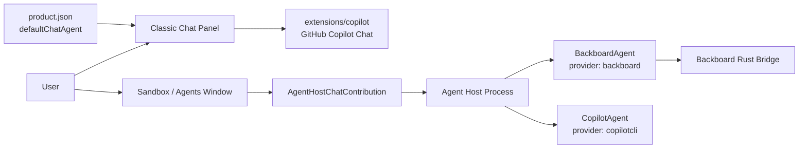

# Sandbox, Agents, Copilot Chat, and Backboard Wiring

This note explains how the Sandbox/Agents window, the agent-host providers, the Backboard Rust bridge, and the classic Copilot Chat extension relate to each other in this codebase.

## Short Answer

They are partially wired together.

The Sandbox/Agents surface and Backboard are wired through the agent-host chat-session system. The classic Copilot Chat feature is still contributed by the bundled Copilot extension and still points at GitHub Copilot product configuration. That means the UI can show Backboard-labeled agent sessions, but the normal Copilot chat participant is not automatically the same thing as the Backboard agent.

## Main Systems

### Classic Copilot Chat Extension

Path:

```text
/Users/erintomorri/Desktop/Backboard/IDE/Espri-API/ide/vscode/extensions/copilot
```

Important files:

```text
extensions/copilot/package.json
extensions/copilot/src/extension/extension/vscode-node/extension.ts
extensions/copilot/src/platform/authentication
extensions/copilot/src/platform/endpoint
extensions/copilot/src/extension/chatSessions/copilotcli
```

What it does:

- Contributes the classic `GitHubCopilot` chat participant.
- Registers Copilot Chat commands, tools, chat participants, chat-session contributions, and language model providers.
- Uses GitHub/Copilot auth and Copilot API/SDK paths.
- Defines a `copilotcli` chat-session type for the Copilot CLI style agent session.

The `chatParticipants` contribution in `extensions/copilot/package.json` includes the default GitHub Copilot participant:

```json
{
  "id": "github.copilot.default",
  "name": "GitHubCopilot",
  "fullName": "GitHub Copilot",
  "isDefault": true
}
```

So classic Copilot Chat is extension-host driven.

### Product Default Chat Agent

Path:

```text
/Users/erintomorri/Desktop/Backboard/IDE/Espri-API/ide/vscode/product.json
```

Current product-level default still points at GitHub Copilot:

```json
"defaultChatAgent": {
  "extensionId": "GitHub.copilot",
  "chatExtensionId": "GitHub.copilot-chat",
  "provider": {
    "default": {
      "id": "github",
      "name": "GitHub"
    }
  }
}
```

This affects setup, sign-in copy, default chat extension lookup, terms/privacy links, and parts of the chat UI that ask which extension is the product's default chat agent.

This is not the same as the Backboard agent-host provider.

### Agent Host

Path:

```text
/Users/erintomorri/Desktop/Backboard/IDE/Espri-API/ide/vscode/src/vs/platform/agentHost
```

Important files:

```text
src/vs/platform/agentHost/node/agentHostMain.ts
src/vs/platform/agentHost/node/agentHostServerMain.ts
src/vs/platform/agentHost/node/agentService.ts
src/vs/platform/agentHost/common/agentService.ts
src/vs/platform/agentHost/node/backboard/backboardAgent.ts
src/vs/platform/agentHost/node/copilot/copilotAgent.ts
```

What it does:

- Runs agent providers in a separate process.
- Surfaces providers to the workbench through `rootState.agents`.
- Creates dynamic chat session types with this naming shape:

```text
agent-host-${agent.provider}
```

Examples:

```text
agent-host-backboard
agent-host-copilotcli
```

### Backboard Agent Provider

Path:

```text
src/vs/platform/agentHost/node/backboard/backboardAgent.ts
```

Provider id:

```ts
readonly id = 'backboard';
```

Dynamic chat session type:

```text
agent-host-backboard
```

What it does:

- Starts the Backboard bridge binary.
- Talks to the Rust-side Backboard runtime through bridge events.
- Presents Backboard model options and session configuration.
- Executes Backboard tool calls through the bridge.
- Reads and writes shared Backboard state under:

```text
~/.backboard_ide/panel-state.json
~/.backboard_ide/threads
```

Bridge binary lookup includes:

```text
extensions/backboard/bin/backboard-bridge
extensions/backboard/rust/target/debug/backboard-bridge
```

### Copilot Agent-Host Provider

Path:

```text
src/vs/platform/agentHost/node/copilot/copilotAgent.ts
```

Provider id:

```ts
readonly id = 'copilotcli';
```

Dynamic chat session type:

```text
agent-host-copilotcli
```

What it does:

- Uses `@github/copilot-sdk`.
- Runs the Copilot SDK agent loop.
- Handles Copilot CLI style sessions, worktrees, slash commands, and permissions.

This is separate from Backboard.

## Current Wiring Map



## Instruction Files Read For This Plan

The wiring plan below follows these repo instructions and design notes:

- `AGENTS.md`: delegates to `.github/copilot-instructions.md`.
- `.github/copilot-instructions.md`: VS Code layering, DI, localization, validation, and TypeScript compile rules.
- `src/vs/platform/agentHost/common/state/AGENTS.md`: do not hand-edit generated AHP protocol unless a real protocol feature requires it.
- `src/vs/platform/agentHost/test/node/AGENTS.md`: agent-host tests touching `SessionDatabase` must use `SessionDatabase.open(':memory:')`.
- `extensions/copilot/src/extension/chatSessions/copilotcli/AGENTS.md`: Copilot CLI is SDK-owned by `@github/copilot/sdk`, layered as `common`, `node`, and `vscode-node`.
- `extensions/copilot/src/platform/authentication/common/AGENTS.md`: Copilot auth is GitHub/CAPI-specific; Backboard auth should not reuse that service casually.
- `.github/instructions/chat.instructions.md`: AI UI must be gated with chat AI feature context.
- `.github/instructions/sessions.instructions.md`: `src/vs/sessions` is a separate Agents Window layer; workbench code must not import from `vs/sessions`.
- `.github/instructions/agentHostTesting.instructions.md`: use the agent-host server and mock-agent paths for AHP-level validation.
- `src/vs/workbench/contrib/chat/chatCodeOrganization.md`: chat UI code belongs under the existing chat folders, especially `browser/agentSessions`, `browser/widget`, `common/participants`, and `common/tools`.

The biggest implication is that the Backboard integration should reuse the existing chat-session and agent-host protocol surfaces. It should not make the Copilot extension import Agents Window internals, and it should not change generated AHP protocol types unless Backboard needs a brand-new client-visible concept.

## Backboard Bridge Command Ownership

The bridge command surface comes from:

```text
extensions/backboard/rust/crates/backboard_bridge/src/main.rs
```

These commands are the stable seam between TypeScript and Rust.

| Bridge command | Rust behavior | Wire it where | Why |
|---|---|---|---|
| `initialize` | Replies with `initialized` and `bridgeProtocolVersion`. | `BackboardBridgeProcess._ensureProcess()` in `src/vs/platform/agentHost/node/backboard/backboardAgent.ts`. | Process startup/health belongs in the agent-host provider, not the chat UI. |
| `listModels` | Calls Backboard model/provider APIs, filters visible LLM models, emits `models` then `done`. | `BackboardAgent._refreshModels()` and `AgentHostLanguageModelProvider`. | Model picker data should flow through agent-host model metadata. |
| `listTools` | Returns mode-filtered tool definitions. | `BackboardAgent.sendMessage()` before first `submitToolResult`. | The LLM needs the same tool schema again when continuing after tool outputs. |
| `runTool` | Rust executes only bridge-owned tools such as `web_search`, `web_fetch`, and unsupported `computer`. | `executeBackboardTool()` delegates only Rust-owned tools to `bridge.runTool()`. | Workspace tools should stay in TypeScript so paths, file IO, terminal output, and UI progress remain local to VS Code. |
| `sendPrompt` | Builds `SendMessageRequest`, augments the prompt with Backboard system prompt/runtime context, streams Backboard SSE. | `BackboardAgent.sendMessage()`. | This is the main chat-turn path for Sandbox/Agents. |
| `submitToolResult` | Submits tool outputs to `/threads/{threadId}/runs/{runId}/submit-tool-outputs?stream=true` and streams the continuation. | `BackboardAgent.sendMessage()` loop after `_executeToolCalls()`. | Tool calls should be executed by the host, then sent back to Backboard for continuation. |
| `cancel` | Sets the bridge cancel flag and emits `done` with `cancelled`. | `BackboardAgent.cancelTurn()` or equivalent cancellation path. | Cancellation must stay per session/turn, not global UI state. |
| `getSession` | Returns remembered `threadId`, `assistantId`, and `runId`. | Use only if reconnect/resume needs bridge-side binding recovery. | Normal `BackboardAgent` state already tracks session metadata; do not add this to UI unless needed. |
| `disposeSession` | Cancels and removes bridge session state. | `BackboardAgent.disposeSession()` or provider disposal. | Cleanup belongs in the agent-host provider. |
| API passthrough commands | Calls Backboard REST wrappers and emits `apiResponse`. | Account/admin/settings UI, not the normal chat-turn path. | These are useful for Backboard panels, billing, assistants, documents, and memory UI, but should not clutter the core chat request flow. |

## Backboard Event Ownership

The bridge emits event objects on stdout. `BackboardBridgeProcess` parses them and routes events to either a pending promise or an `onEvent` callback.

| Bridge event | Current meaning | TypeScript owner | Workbench output |
|---|---|---|---|
| `initialized` | Bridge is alive and protocol version is known. | `BackboardBridgeProcess`. | Usually no visible UI. |
| `models` | Model list from Backboard. | `BackboardAgent._refreshModels()`. | Chat model picker via agent-host model provider. |
| `tools` | Tool definitions for a mode. | `BackboardAgent.sendMessage()`. | Included in `submitToolResult`, not directly shown. |
| `toolFinished` | Result from a Rust-owned tool. | `BackboardBridgeProcess.runTool()`. | Folded into a tool result. |
| `progress` | Status text such as "Sending to Backboard." | `BackboardAgent._handleBridgeEvent()` should map this to session progress if wanted. | Optional progress rows or status text. |
| `assistantTextDelta` | Visible assistant text stream. | `BackboardAgent._handleBridgeEvent()`. | `SessionResponsePart` and `SessionDelta`. |
| `reasoningDelta` | Reasoning stream. | Backboard-specific enhancement in `BackboardAgent._handleBridgeEvent()`. | Could map to a reasoning response part if the existing AHP UI supports it; otherwise keep hidden/logged. |
| `toolRequested` | Backboard run requires host tool outputs. | `BackboardAgent._handleBridgeEvent()` queues a `ToolResultRequest`. | Tool call rows via `_executeToolCalls()`. |
| `media` | Generated media chunk. | Backboard-specific enhancement in `BackboardAgent._handleBridgeEvent()`. | Could become a response part or attachment preview if supported. |
| `voice` | TTS/STT stream chunk. | Backboard-specific enhancement in `BackboardAgent._handleBridgeEvent()`. | Not core for first chat wiring. |
| `usage` | Token/billing/usage chunk. | `BackboardAgent._handleBridgeEvent()` or account UI. | Could feed usage status/popup. |
| `apiResponse` | Result from an API passthrough command. | Backboard admin/account webview or future workbench settings UI. | Not normal chat response. |
| `error` | Bridge or Backboard API failure. | `BackboardAgent._handleBridgeEvent()`. | `SessionError`. |
| `done` | Request complete, cancelled, errored, or waiting for tool result. | `BackboardBridgeProcess` promise resolution and `BackboardAgent.sendMessage()` loop. | `SessionTurnComplete` after all continuations finish. |

## Backboard HTTP Endpoint Families

Endpoint route constants are in:

```text
extensions/backboard/rust/crates/backboard/src/endpoints/routes.rs
```

Config and auth are in:

```text
extensions/backboard/rust/crates/backboard/src/endpoints/config.rs
extensions/backboard/rust/crates/backboard/src/endpoints/client.rs
```

Base URLs:

```text
prod:  https://app.backboard.io/api
dev:   https://dev.app.backboard.io/api
local: http://localhost:8000
```

Credential lookup order:

```text
~/.backboard_ide/config.json -> env_keys[current env]
~/.backboard_ide/config.json -> api_key
BACKBOARD_API_KEY
```

HTTP header:

```text
X-API-Key: <api key>
```

| Endpoint family | Route shape | Bridge/API commands | Wire it where |
|---|---|---|---|
| Assistants | `/assistants`, `/assistants/{assistantId}` | `createAssistant`, `listAssistants`, `getAssistant`, `updateAssistant`, `deleteAssistant` | Backboard admin or assistant-management UI. Not required for basic Sandbox chat. |
| Assistant threads | `/assistants/{assistantId}/threads` | `createAssistantThread`, `listAssistantThreads` | Assistant-specific UI or persisted assistant workflows. |
| Assistant documents | `/assistants/{assistantId}/documents` | `listAssistantDocuments`, `uploadAssistantDocument` | Document upload/manage UI. |
| Threads | `/threads`, `/threads/{threadId}` | `listThreads`, `getThread`, `deleteThread`, `sendMessage`, `addThreadMessage` | Chat session restore/history, but normal live turns should go through `sendPrompt`. |
| Thread documents | `/threads/{threadId}/documents` | `listThreadDocuments`, `uploadThreadDocument` | Per-thread attachment UI. |
| Tool outputs | `/threads/{threadId}/runs/{runId}/submit-tool-outputs?stream=true` | `submitToolResult`, `submitToolOutputsSimple` | Core chat-turn loop after host executes tools. |
| Run cancel | `/threads/{threadId}/runs/{runId}/cancel` | Currently route exists in Rust client routes. | Wire to cancellation only if server-side cancel is exposed in client wrapper. |
| Models | `/models`, `/models/providers`, `/models/provider/{provider}` | `listModels`, `listProviders`, `listModelsByProvider`, `getModel` | Agent-host model provider and model picker. |
| Embeddings | embedding model/provider wrappers | `listEmbeddingModels`, `listEmbeddingProviders`, `getEmbeddingModel` | Settings/admin UI only unless embedding features are exposed. |
| Memories | `/assistants/{assistantId}/memories` style wrappers | `listMemories`, `searchMemories`, `addMemory`, `getMemory`, `updateMemory`, `deleteMemory`, `getMemoryOperationStatus` | Memory management UI. For normal turns, use `memoryMode` on `sendPrompt`. |
| Documents | document status/delete wrappers | `getDocumentStatus`, `deleteDocument` | Document management UI. |
| Billing/usage | `/billing/usage/recent` plus balance/summary wrappers | `getBillingBalance`, `getRecentUsage`, `getUsageSummary` | Account/usage popover or settings UI. |

## Tool Execution Split

Backboard advertises tool definitions from Rust, but most tools should execute in TypeScript because they touch the local workspace or VS Code UI.

### TypeScript-owned local workspace tools

Owner:

```text
src/vs/platform/agentHost/node/backboard/backboardAgent.ts
```

Function:

```ts
executeBackboardTool(...)
```

Tools:

```text
read_file
list_dir
glob
grep
codebase_search
write
write_file
create_file
overwrite_file
edit
edit_file
search_replace
delete_file
create_directory
bash
run_terminal_cmd
run_code
repl
todo_write
sleep
task
enter_plan_mode
exit_plan_mode
persistence_decide
```

Why TypeScript owns them:

- They need workspace-root resolution.
- They need local file system access.
- Shell output should stream into the workbench tool-call row.
- Approval and mode handling must match the Sandbox session.

### Rust-owned bridge/network tools

Owner:

```text
extensions/backboard/rust/crates/backboard_bridge/src/main.rs
```

Tools:

```text
web_search
web_fetch
computer
```

Current behavior:

- `web_search` uses DuckDuckGo instant answer JSON.
- `web_fetch` fetches HTTP/HTTPS content with private/local network blocking.
- `computer` returns unsupported in the VS Code bridge.

Keep this split unless a tool requires VS Code APIs. If it needs VS Code UI or workspace state, put it in `BackboardAgent`. If it is pure network/API and should work outside VS Code, keep it in Rust.

## Concrete "What Goes Where" Wiring Plan

### A. Sandbox/Agents entry points

Files:

```text
src/vs/workbench/contrib/chat/electron-browser/agentSessions/agentSessionsActions.ts
src/vs/workbench/contrib/chat/common/chatSessionsService.ts
src/vs/workbench/contrib/chat/electron-browser/chat.contribution.ts
```

Wire:

- `Open Sandbox Window`
- `Open in Sandbox Window`
- handoff tips
- default agent-host session alias

Target session type:

```text
agent-host-backboard
```

Use:

```ts
SessionType.AgentHostCopilot
```

because that alias currently resolves to:

```ts
'agent-host-backboard'
```

Do not use:

```ts
SessionType.CopilotCLI
```

unless the user explicitly wants the GitHub Copilot SDK-backed CLI session.

### B. Agent-host provider registration

Files:

```text
src/vs/platform/agentHost/node/agentHostMain.ts
src/vs/platform/agentHost/node/agentHostServerMain.ts
```

Wire:

```ts
agentService.registerProvider(instantiationService.createInstance(BackboardAgent));
```

before:

```ts
agentService.registerProvider(instantiationService.createInstance(CopilotAgent));
```

Why:

- Backboard should be available in both desktop utility-process agent host and standalone WebSocket agent host.
- The workbench resolver waits for provider `backboard`.

### C. Chat session contribution and content provider

File:

```text
src/vs/workbench/contrib/chat/browser/agentSessions/agentHost/agentHostChatContribution.ts
```

Do not hardcode Backboard here beyond Backboard-specific presentation exceptions that already exist. This file should keep registering every provider from `rootState.agents` dynamically.

For provider:

```text
backboard
```

it creates:

```text
agent-host-backboard
```

and wires it to:

```text
AgentHostSessionHandler
AgentHostLanguageModelProvider
AgentHostSessionListController
```

### D. Backboard chat turn execution

File:

```text
src/vs/platform/agentHost/node/backboard/backboardAgent.ts
```

Wire the turn exactly this way:

```text
sendMessage()
  -> _materialize()
  -> _turnSettings()
  -> bridge.listTools(mode)
  -> bridge.send("sendPrompt", ...)
  -> _handleBridgeEvent()
  -> _executeToolCalls()
  -> bridge.send("submitToolResult", ...)
  -> repeat until no toolRequested
  -> SessionTurnComplete
```

This is the right home for:

- prompt to Backboard conversion
- model/provider/mode settings
- local tool execution
- Backboard continuation after tools
- shared Backboard thread writes
- session restore from `~/.backboard_ide`

### E. Model picker

Files:

```text
src/vs/platform/agentHost/node/backboard/backboardAgent.ts
src/vs/workbench/contrib/chat/browser/agentSessions/agentHost/agentHostChatContribution.ts
```

Wire:

```text
Backboard bridge listModels
  -> BackboardAgent.models observable
  -> AgentHostLanguageModelProvider
  -> chat model picker
```

Do not fetch models directly from the workbench UI.

### F. API key and SSO

Existing Backboard config path:

```text
~/.backboard_ide/config.json
```

Existing setup UI path:

```text
src/vs/workbench/contrib/chat/browser/chatSetup/chatSetupRunner.ts
```

Existing extension SSO path:

```text
extensions/backboard/src/extension.ts
```

Keep credential writes in the Backboard config path. The bridge already loads credentials from `BackboardConfig::load_or_default()` and accepts per-request overrides through `ConfigParams`.

Do not route Backboard auth through:

```text
extensions/copilot/src/platform/authentication
```

That service is explicitly GitHub/CAPI-specific.

### G. Classic Copilot Chat replacement

Files if you choose to replace it:

```text
product.json
extensions/copilot/package.json
src/vs/workbench/contrib/chat/browser/chatSetup
src/vs/workbench/contrib/chat/common/participants
```

Recommended path:

Create or register a Backboard chat participant that opens/targets `agent-host-backboard` instead of trying to mutate the GitHub Copilot participant in place.

Avoid changing only `product.json`. That would point setup and default-chat lookup at Backboard-looking metadata while the actual participant and auth path remain GitHub Copilot.

### H. Account, usage, memory, documents, and assistants UI

Use API passthrough bridge commands only for non-chat-turn UI:

```text
getBillingBalance
getRecentUsage
getUsageSummary
listAssistants
listThreads
listMemories
uploadThreadDocument
...
```

Good homes:

```text
extensions/backboard/src/extension.ts
src/vs/workbench/contrib/chat/browser/chatSetup
future Backboard account/settings contribution
```

Do not put these calls into `BackboardAgent.sendMessage()` unless the chat turn itself needs them.

## Implementation Order I Would Use

1. Finish the Sandbox handoff cleanup.
   - Change empty handoff fallback from `SessionType.CopilotCLI` to `SessionType.AgentHostCopilot`.
   - Change Copilot CLI copy to Backboard copy.

2. Keep Backboard provider registration in both agent-host entry points.
   - Desktop utility process: `agentHostMain.ts`.
   - Standalone WebSocket server: `agentHostServerMain.ts`.

3. Add missing bridge event rendering only where it matters.
   - Keep `assistantTextDelta`, `toolRequested`, `error`, and `done` as core.
   - Add `progress`, `usage`, `media`, and `reasoningDelta` only if the UI has a clear render target.

4. Add focused tests around session routing.
   - `AgentHostCopilot` should resolve to `agent-host-backboard`.
   - open-in-sandbox fallback should prefer `SessionType.AgentHostCopilot`.
   - Backboard registration should appear in standalone server startup paths if testable.

5. Only then decide whether classic Copilot Chat becomes Backboard.
   - If yes, create a Backboard participant or adapter.
   - Avoid mutating GitHub Copilot auth/endpoint internals until the Backboard participant exists.

## What Is Already Wired To Backboard

### Agent-host Backboard provider

The Backboard provider exists and registers as `backboard`.

Desktop utility process registration:

```text
src/vs/platform/agentHost/node/agentHostMain.ts
```

Standalone server registration:

```text
src/vs/platform/agentHost/node/agentHostServerMain.ts
```

The standalone server was missing Backboard registration and has now been patched so it registers `BackboardAgent` before `CopilotAgent`.

### Dynamic chat-session registration

Path:

```text
src/vs/workbench/contrib/chat/browser/agentSessions/agentHost/agentHostChatContribution.ts
```

This file watches `rootState.agents`. For each provider, it registers:

- a chat session contribution
- a session list controller
- an external customization harness
- a session content provider
- a language model provider

For Backboard:

```text
provider: backboard
session type: agent-host-backboard
```

### Backboard alias for the old AgentHostCopilot slot

Path:

```text
src/vs/workbench/contrib/chat/common/chatSessionsService.ts
```

Current alias:

```ts
export const AgentHostCopilot = 'agent-host-backboard';
```

This means product code that still uses the historic name `AgentHostCopilot` resolves to the Backboard agent-host session type.

## What Is Not Fully Wired Yet

### Classic Copilot Chat is still GitHub Copilot

The normal chat participant is still contributed by:

```text
extensions/copilot/package.json
```

The product default still points at:

```text
GitHub.copilot
GitHub.copilot-chat
```

So the standard Copilot Chat participant and setup flow are not automatically backed by Backboard.

### Empty-session Sandbox handoff still has Copilot CLI fallback path

Path:

```text
src/vs/workbench/contrib/chat/electron-browser/agentSessions/agentSessionsActions.ts
```

Current no-real-session fallback still preselects:

```ts
preferredSessionType = {
  providerId: LOCAL_AGENT_HOST_PROVIDER_ID,
  sessionTypeId: SessionType.CopilotCLI
};
```

For a Backboard-first product, this should become:

```ts
preferredSessionType = {
  providerId: LOCAL_AGENT_HOST_PROVIDER_ID,
  sessionTypeId: SessionType.AgentHostCopilot
};
```

Because `SessionType.AgentHostCopilot` now means:

```text
agent-host-backboard
```

### Handoff tip text still mentions Copilot CLI

Same file:

```text
src/vs/workbench/contrib/chat/electron-browser/agentSessions/agentSessionsActions.ts
```

There are still user-facing strings like:

```text
Copilot CLI [Agent Host] isn't available without an open folder
Open the Sandbox Window to start a Copilot CLI session.
Free with your Copilot plan
```

Those should be changed to Backboard/Sandbox language if the product is meant to be Backboard-first.

## Recommended Refactor Path

### Phase 1: make Sandbox/Agents consistently Backboard

Goal:

Every Sandbox/Agents entry point should land on `agent-host-backboard`, not `copilotcli`.

Change:

```text
src/vs/workbench/contrib/chat/electron-browser/agentSessions/agentSessionsActions.ts
```

Replace empty-session fallback:

```ts
sessionTypeId: SessionType.CopilotCLI
```

with:

```ts
sessionTypeId: SessionType.AgentHostCopilot
```

Update comments and copy from Copilot CLI to Backboard.

Why:

This keeps the current architecture intact while fixing the user-visible Sandbox route.

### Phase 2: decide what "Copilot Chat feature" should mean

There are two realistic options.

Option A: Keep classic Copilot Chat separate.

- Classic chat remains GitHub Copilot.
- Sandbox/Agents is Backboard.
- Lowest risk.
- Clear separation if the Sandbox surface is labeled as Backboard.

Option B: Make classic chat default to Backboard.

This is larger. You would need to update:

```text
product.json
extensions/copilot/package.json
extensions/copilot/src/platform/authentication
extensions/copilot/src/platform/endpoint
extensions/copilot/src/extension/prompts
```

You would either:

- create a new Backboard chat extension/participant, or
- heavily fork the Copilot extension so its participant talks to Backboard instead of GitHub Copilot.

The safer approach is to create a Backboard participant instead of mutating every GitHub Copilot codepath in place.

### Phase 3: bridge classic chat to Backboard through agent-host sessions

If the regular Chat panel should create Backboard-backed sessions, use the existing chat-session system instead of reimplementing the Backboard protocol inside the Copilot extension.

Core idea:

```text
Classic chat entry point
  -> opens/selects agent-host-backboard session
  -> AgentHostSessionHandler
  -> BackboardAgent
  -> Backboard Rust bridge
```

Important path:

```text
src/vs/workbench/contrib/chat/electron-browser/chat.contribution.ts
```

This already resolves Backboard from the agent-host root state:

```ts
rootState.agents.find(a => a.provider === 'backboard')
```

and opens:

```text
agent-host-backboard
```

### Phase 4: clean product defaults if Backboard fully replaces GitHub Copilot

If Backboard should be the product's actual default chat agent, update:

```text
product.json
```

Do this only after there is a real Backboard chat participant or a deliberate replacement for `GitHub.copilot-chat`.

Do not just change `product.json` first. Many setup, auth, output-channel, and entitlement paths assume the GitHub Copilot extension exists.

## Practical Next Code Patch

The next focused patch should be:

```text
src/vs/workbench/contrib/chat/electron-browser/agentSessions/agentSessionsActions.ts
```

Expected changes:

1. Change empty-session Sandbox preferred target from `SessionType.CopilotCLI` to `SessionType.AgentHostCopilot`.
2. Change comments from "Copilot CLI" to "Backboard".
3. Change empty-workspace copy to Backboard.
4. Change handoff tip copy away from "Free with your Copilot plan" if this product should not mention Copilot plans.

That gives a coherent Sandbox/Agents path without touching the risky Copilot extension internals.

## Validation Commands

Use the repo's direct TypeScript check:

```sh
PATH="/Users/erintomorri/.cache/codex-runtimes/codex-primary-runtime/dependencies/node/bin:$PATH" ./node_modules/.bin/tsgo --project ./src/tsconfig.json --noEmit --skipLibCheck
```

If npm is available in the shell, the equivalent repo script is:

```sh
npm run compile-check-ts-native
```
