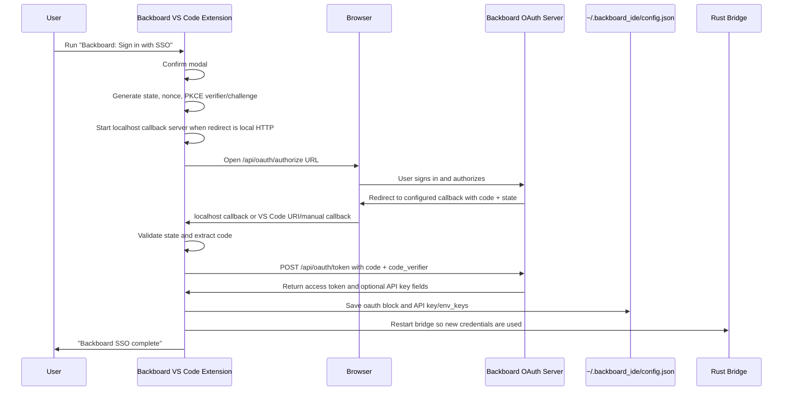

# Backboard SSO / OAuth Deep Dive

This document walks through the Backboard Studio SSO implementation in the
copied extension host.

Primary implementation file:

```text
source-copies/typescript/extensions-backboard/src/extension.ts
```

Isolated SSO implementation copy:

```text
source-copies/typescript/extensions-backboard/sso/extension.sso.ts
```

Package contributions and settings:

```text
source-copies/typescript/extensions-backboard/sso/package.json
```

The SSO code is TypeScript-side only. The Rust bridge does not perform OAuth.
The TypeScript extension obtains tokens, writes credentials to
`~/.backboard_ide/config.json`, restarts the Rust bridge, and the Rust bridge
then reads the saved credentials for API calls.

## High-Level Flow



## Entry Points

### Commands Registered In `activate`

The extension registers these auth-related commands:

| Command | UI title | Implementation |
| --- | --- | --- |
| `backboard.setApiKey` | Not directly listed in package commands | `setApiKey` legacy API-key input |
| `backboard.signIn` | `Sign in with SSO` | `promptBackboardSso` |
| `backboard.copyOAuthRedirectUri` | `Copy OAuth Redirect URI` | `copyBackboardOAuthRedirectUri` |
| `backboard.completeOAuthCallback` | `Complete OAuth Callback` | `completeBackboardOAuthCallbackFromInput` |

The extension also registers:

```ts
vscode.window.registerUriHandler({
  handleUri: uri => handleBackboardOAuthCallback(uri)
})
```

That is the VS Code URI callback path for non-localhost redirect flows.

### Package Activation

`package.json` activates the extension when these commands are invoked:

```json
[
  "onCommand:backboard.signIn",
  "onCommand:backboard.copyOAuthRedirectUri",
  "onCommand:backboard.completeOAuthCallback"
]
```

The Backboard panel also shows the sign-in command when the context key
`backboard.authenticated` is false.

### Panel Entry Points

The webview posts messages such as:

- `setApiKey`
- `signIn`

Both currently call `promptBackboardSso(bridge)` from the panel handler. Despite
the `setApiKey` message name, the panel route prefers SSO.

## Constants

The auth constants are defined near the top of `extension.ts`.

| Constant | Value / purpose |
| --- | --- |
| `backboardOAuthAuthorizeUrl` | `https://app.backboard.io/api/oauth/authorize` |
| `backboardOAuthTokenUrl` | `https://app.backboard.io/api/oauth/token` |
| `backboardOAuthClientId` | Public OAuth client identifier used by the IDE |
| `defaultBackboardOAuthRedirectUri` | `http://127.0.0.1:49321/auth/callback` |
| `backboardOAuthScope` | `openid email profile` |
| `pendingBackboardOAuth` | Single in-memory pending login attempt |

The client ID is not treated as a secret in this code. The flow uses PKCE, so
the code exchange relies on a per-login `code_verifier` rather than a client
secret embedded in the app.

## Settings

Relevant `package.json` settings:

| Setting | Purpose |
| --- | --- |
| `backboard.env` | Selects `prod`, `dev`, or `local` API environment. |
| `backboard.apiUrl` | Custom API base URL override. |
| `backboard.apiKey` | Legacy API-key fallback setting. |
| `backboard.oauthRedirectUri` | Optional OAuth redirect URI override. |

Default redirect behavior:

```text
http://127.0.0.1:49321/auth/callback
```

If `backboard.oauthRedirectUri` is set, `backboardOAuthCallbackUri()` returns it
instead of the default.

## Step 1: User Confirms SSO

`promptBackboardSso` shows a modal confirmation:

```text
Sign in to Backboard Studio.
```

Button:

```text
Continue with SSO
```

If the user dismisses the modal, the function returns `false` and no auth flow
starts.

If the user chooses the button, it calls:

```ts
signInBackboard(bridge)
```

## Step 2: Generate OAuth Anti-Forgery And PKCE Values

`signInBackboard` creates:

| Value | Generation | Used for |
| --- | --- | --- |
| `state` | `crypto.randomBytes(24).toString('base64url')` | CSRF/callback correlation. |
| `nonce` | `crypto.randomBytes(24).toString('base64url')` | OIDC nonce sent to authorize endpoint. |
| `codeVerifier` | `crypto.randomBytes(32).toString('base64url')` | PKCE secret kept only locally during flow. |
| `codeChallenge` | `sha256(codeVerifier).base64url` | PKCE challenge sent to authorize endpoint. |

The code challenge method is:

```text
S256
```

Important detail:

- `state` is validated on callback.
- `code_verifier` is sent during token exchange.
- `nonce` is sent to the authorization endpoint, but this implementation does
  not currently parse and validate the returned `id_token` nonce.

## Step 3: Determine Redirect URI

`backboardOAuthCallbackUri()` checks:

```ts
vscode.workspace.getConfiguration('backboard').get<string>('oauthRedirectUri')
```

If configured and non-empty, that value is used.

Otherwise it uses:

```text
http://127.0.0.1:49321/auth/callback
```

The redirect URI must match the URI registered in the Backboard OAuth app.

The command `backboard.copyOAuthRedirectUri` copies the default redirect URI to
the clipboard and tells the user to register that exact URI in Backboard.

## Step 4: Start Callback Receiver

`startBackboardOAuthCallbackServer(redirectUri)` only starts a local HTTP server
when all of these are true:

- Scheme is `http:`.
- Host is `127.0.0.1` or `localhost`.
- Port is a valid integer from 1 to 65535.

For the default URI, it listens on:

```text
127.0.0.1:49321
```

Path:

```text
/auth/callback
```

If the redirect URI is not local HTTP, the function returns `undefined` and the
flow still continues. In that case, the code must arrive through one of the
fallback mechanisms:

- VS Code URI handler: `handleBackboardOAuthCallback`.
- Manual paste command: `backboard.completeOAuthCallback`.

### Local Callback Server Behavior

When the browser redirects back to the local server:

1. The server checks that the request path matches the configured callback path.
2. If the path does not match, it returns `404 Not Found`.
3. If the path matches, it passes the query string to
   `completeBackboardOAuthCallback`.
4. It returns an HTML success or failure page.
5. On success, the page tries to close itself after roughly 1.2 seconds.

Success page title:

```text
Backboard sign in complete
```

Failure page title:

```text
Backboard sign in could not be completed
```

The callback server is disposed after the code is received or when the sign-in
attempt exits through `finally`.

## Step 5: Register Pending OAuth Attempt

`waitForBackboardOAuthCode(state)` creates one pending auth attempt.

Behavior:

- If another auth attempt is already pending, it rejects the old one with:
  `A new Backboard sign in was started.`
- It stores:
  - expected `state`
  - `resolve(code)`
  - `reject(error)`
  - timeout handle
- Timeout is 5 minutes.

Timeout error:

```text
Timed out waiting for Backboard sign in callback.
```

This is deliberately single-flight. The module-level `pendingBackboardOAuth`
means the extension only tracks one pending sign-in at a time.

## Step 6: Build Authorization URL

The authorize URL query parameters:

| Query param | Value |
| --- | --- |
| `client_id` | Backboard OAuth client ID |
| `redirect_uri` | Default or configured redirect URI |
| `response_type` | `code` |
| `scope` | `openid email profile` |
| `state` | Random state |
| `code_challenge` | SHA-256 PKCE challenge |
| `code_challenge_method` | `S256` |
| `nonce` | Random nonce |

Shape:

```text
https://app.backboard.io/api/oauth/authorize
  ?client_id=...
  &redirect_uri=http%3A%2F%2F127.0.0.1%3A49321%2Fauth%2Fcallback
  &response_type=code
  &scope=openid+email+profile
  &state=...
  &code_challenge=...
  &code_challenge_method=S256
  &nonce=...
```

The extension logs the authorize URL to the `Backboard Tools` output channel.
That log is helpful for debugging but can expose auth flow parameters during the
short login window.

## Step 7: Open The Browser

`openBackboardOAuthAuthorizeUrl(authorizeUrl)` opens the authorize URL.

Platform behavior:

| Platform | Open behavior |
| --- | --- |
| macOS | Calls `/usr/bin/open <authorizeUrl>` via `cp.execFile`. |
| Other platforms | Uses `vscode.env.openExternal`. |

The comments/logs say this opens the Backboard authorize URL first, then the
browser redirects back to the registered callback URI after approval.

## Step 8: Callback Validation

All callback paths eventually call:

```ts
completeBackboardOAuthCallback(queryString)
```

It validates in this order:

1. There must be a pending OAuth attempt.
2. Query `state` must equal the pending state.
3. If query includes `error`, reject with the error and optional
   `error_description`.
4. Query must include a non-empty `code`.
5. Resolve the pending promise with the code.

### No Pending Attempt

If no sign-in is pending:

```text
Ignoring Backboard callback because no sign in is pending.
```

The function returns `false`.

### State Mismatch

If callback state does not match pending state:

```text
OAuth state did not match.
```

The implementation clears the pending attempt and returns `true` because it did
handle the callback, even though it rejected the login.

### OAuth Error Callback

If Backboard redirects with:

```text
error=access_denied&error_description=...
```

The pending login is rejected with either:

```text
<error>: <description>
```

or just:

```text
<error>
```

### Missing Code

If there is no `code` query parameter:

```text
Missing Backboard authorization code.
```

## Step 9: Fallback Callback Mechanisms

### Localhost HTTP Callback

Default path:

```text
http://127.0.0.1:49321/auth/callback?code=...&state=...
```

This is the normal path if port `49321` is available and the OAuth app has the
default redirect URI registered.

### VS Code URI Handler

The extension registers a URI handler and accepts only:

```text
/auth/callback
```

Then it passes `uri.query` into `completeBackboardOAuthCallback`.

This supports custom redirect URI setups that route back to VS Code, assuming
the URI path matches `/auth/callback`.

### Manual Callback Paste

Command:

```text
Backboard: Complete OAuth Callback
```

It prompts:

```text
Paste the full callback URL from the browser, including code and state.
```

Then it parses the URL, extracts `uri.query`, and calls
`completeBackboardOAuthCallback`.

This is useful when:

- The local callback server could not bind.
- The browser could not reach localhost.
- A custom redirect URI does not automatically return to VS Code.
- The browser lands on a callback URL the user can copy.

## Step 10: Token Exchange

After the authorization code resolves, `signInBackboard` disposes the local
callback server and calls:

```ts
exchangeBackboardOAuthCode(code, redirectUri, codeVerifier)
```

Token endpoint:

```text
POST https://app.backboard.io/api/oauth/token
Content-Type: application/x-www-form-urlencoded
```

Body:

```text
grant_type=authorization_code
code=<authorization code>
redirect_uri=<same redirect URI used during authorize>
client_id=<Backboard OAuth client ID>
code_verifier=<original PKCE code verifier>
```

The code uses a helper:

```ts
postForm(backboardOAuthTokenUrl, body, 'Backboard token request')
```

`postForm` uses Node `https.request`, collects the response body, and rejects
for non-2xx status codes with:

```text
Backboard token request returned HTTP <status>: <response body>
```

After a 2xx response, `exchangeBackboardOAuthCode` parses JSON and requires
`access_token` to exist.

If the response is not an object:

```text
Backboard token response was not an object.
```

If no access token is present:

```text
Backboard token response did not include an access token.
```

## Token Response Shape

The extension accepts this token response shape:

```ts
interface BackboardOAuthTokens {
  api_key?: string | null;
  apiKey?: string | null;
  access_token?: string;
  refresh_token?: string;
  token_type?: string;
  expires_in?: number;
  scope?: string;
  id_token?: string | null;
  assistant_id?: string | null;
  backboard_api_key?: string | null;
  personal_api_key?: string | null;
  selected_client_name?: string | null;
}
```

Important fields:

| Field | Used for |
| --- | --- |
| `access_token` | Required; saved under `oauth.access_token`. |
| `refresh_token` | Saved if present, but no refresh flow is implemented here. |
| `id_token` | Saved if present, but not validated here. |
| `assistant_id` | Saved if present and returned from save helper. |
| `api_key` / `apiKey` | Preferred direct API key if present. |
| `backboard_api_key` | Fallback API key if direct API key absent. |
| `personal_api_key` | Fallback API key if other key fields absent. |
| `selected_client_name` | Saved as metadata. |

## Step 11: Save Credentials

`saveBackboardOAuthTokens(tokens)` writes to:

```text
~/.backboard_ide/config.json
```

For the full credential storage map, see `CREDENTIALS.md`.

The save helper requires `access_token`. It then chooses a usable API key in
this priority order:

1. `api_key`
2. `apiKey`
3. `backboard_api_key`
4. `personal_api_key`

If a usable API key exists, it is saved both as:

- top-level `api_key`
- `env_keys[env]`

The environment is selected from existing config or current VS Code setting:

```ts
normalizeBackboardEnv(stringValueFromRecord(config.env) || currentBackboardEnv())
```

Environment normalization:

| Input | Saved env |
| --- | --- |
| empty / missing | `prod` |
| `production` | `prod` |
| `development` | `dev` |
| anything else | lowercased trimmed value |

### Saved Config Example

After successful SSO, the config can look like:

```json
{
  "env": "prod",
  "api_key": "bb_api_key_or_personal_key",
  "env_keys": {
    "prod": "bb_api_key_or_personal_key"
  },
  "oauth": {
    "access_token": "oauth_access_token",
    "refresh_token": "optional_refresh_token",
    "token_type": "Bearer",
    "expires_in": 3600,
    "scope": "openid email profile",
    "id_token": "optional_id_token",
    "assistant_id": "optional_assistant_id",
    "api_key": "direct_api_key_if_present",
    "backboard_api_key": "backboard_api_key_if_present",
    "personal_api_key": "personal_api_key_if_present",
    "selected_client_name": "optional client name",
    "obtained_at": "2026-06-17T12:34:56.789Z"
  }
}
```

### File Write Details

`writeBackboardConfigJson`:

1. Creates `~/.backboard_ide`.
2. Writes JSON to a temp file with mode `0600`.
3. Renames the temp file into place.
4. On non-Windows, chmods final config to `0600`.
5. Calls `updateBackboardAuthContext`.

This is an atomic-ish write pattern to avoid partially written config files.

## Step 12: Auth Context Update

`hasBackboardCredentials()` returns true if config contains either:

- a usable API key, or
- an OAuth access token.

Then:

```ts
vscode.commands.executeCommand('setContext', 'backboard.authenticated', trueOrFalse)
```

That context key controls whether sign-in commands are shown in Backboard view
menus.

A file watcher also watches `~/.backboard_ide/config.json`. When the config is
created, changed, or deleted, it:

- updates `backboard.authenticated`
- refreshes panel state

## Step 13: Restart The Rust Bridge

After saving tokens:

```ts
bridge.restart()
```

`BackboardBridge.restart()` kills the current bridge process if it exists and
clears pending model refresh state. The next bridge call starts a fresh Rust
process.

Why this matters:

- The Rust bridge/client loads credentials from config.
- Existing bridge process state may have stale auth.
- Restarting forces subsequent Backboard API calls to use the new saved API key
  or token-derived key.

If an API key was saved, the extension logs:

```text
Backboard SSO complete. API key saved to ~/.backboard_ide/config.json.
```

Then it shows:

```text
Backboard SSO complete.
```

## Legacy API Key Flow

There is still a direct API-key command path:

```ts
setApiKey()
```

It shows a password input:

```text
Backboard API Key
Stored in ~/.backboard_ide/config.json.
```

Behavior:

- Non-empty input calls `saveBackboardConfigApiKey(apiKey)`.
- Empty input clears the current env API key via `clearBackboardConfigApiKey`.
- If credentials changed, the caller restarts the bridge.

`saveBackboardConfigApiKey` writes:

```json
{
  "env": "prod",
  "api_key": "manual-api-key",
  "env_keys": {
    "prod": "manual-api-key"
  }
}
```

The package setting `backboard.apiKey` is described as a legacy fallback, but
the SSO flow writes to `~/.backboard_ide/config.json`.

## Error Handling

### User Cancels Modal

`promptBackboardSso` returns `false`.

No browser opens, no callback server starts.

### Callback Server Cannot Start

If default/local redirect URI is used and server bind fails, the flow rejects
with:

```text
Could not start Backboard OAuth callback server on <uri>: <error>
```

Common causes:

- Port `49321` is already in use.
- Local firewall/security policy blocks binding.
- Invalid configured local URI.

### Invalid Local Redirect URI

If redirect URI is local HTTP but port is absent or invalid:

```text
Backboard OAuth redirect URI must include a valid localhost port: <uri>
```

### Timeout

If no callback arrives within 5 minutes:

```text
Timed out waiting for Backboard sign in callback.
```

### State Mismatch

If callback state differs:

```text
OAuth state did not match.
```

This protects against stale, cross-tab, or forged callbacks.

### OAuth Provider Error

If Backboard redirects with `error`, the displayed message is either:

```text
<error>: <error_description>
```

or:

```text
<error>
```

### Token HTTP Error

If token exchange is non-2xx:

```text
Backboard token request returned HTTP <status>: <body>
```

### Token Shape Error

If response JSON is malformed, not an object, or lacks `access_token`, the flow
rejects before saving config.

### Final Catch

`signInBackboard` catches all errors, logs to `Backboard Tools`, shows a VS Code
error message, and returns `false`.

## What Is Not Implemented Here

The system prompt mentions OAuth URLs:

- `/api/oauth/authorize`
- `/api/oauth/token`
- `/api/oauth/userinfo`
- `/api/oauth/revoke`

This extension implementation currently uses:

- authorize endpoint
- token endpoint

It does not currently implement:

- refresh-token exchange
- token revocation
- userinfo fetch
- id-token signature/nonce validation
- OAuth logout
- automatic retry on expired access token

The practical reason it still works for API calls is that Backboard's token
response can include a usable API key field. The extension saves that API key
into `api_key` and `env_keys`, and the Rust API client uses API-key auth.

## Security Properties

Implemented protections:

- Authorization-code flow rather than implicit flow.
- PKCE `S256`.
- Random `state` validation.
- Local callback path check.
- Single pending auth attempt.
- Five-minute pending login timeout.
- Config written with `0600` permissions on non-Windows.
- API keys/token-like fields are redacted by `redactSensitiveValues` in bridge
  request logs.

Important caveats:

- The config file stores OAuth tokens and API keys on disk. Permissions are
  restricted, but this is not OS keychain storage.
- The nonce is generated and sent but not validated against the returned
  `id_token` in this implementation.
- Refresh tokens may be saved, but there is no refresh workflow here.
- The authorize URL is logged to the `Backboard Tools` output channel.
- The default local callback port is fixed at `49321`; if occupied, sign-in
  fails unless the redirect URI or callback completion path is changed.

## Troubleshooting Checklist

### Browser never opens

Check:

- Command `backboard.signIn` is registered.
- Platform-specific opener did not fail.
- On macOS, `/usr/bin/open` is available.
- Output channel `Backboard Tools` for `[oauth]` lines.

### Browser opens but callback fails

Check:

- OAuth app registered redirect URI exactly matches the extension redirect URI.
- Default URI is `http://127.0.0.1:49321/auth/callback`.
- Port `49321` is available.
- Browser can reach `127.0.0.1`.
- Callback path is `/auth/callback`.
- Use `Backboard: Complete OAuth Callback` as fallback if browser shows a URL
  containing `code` and `state`.

### State mismatch

Likely causes:

- Callback from an old sign-in attempt.
- Two sign-in attempts started; new attempt invalidated old pending state.
- Browser tab from previous attempt was approved after a new flow started.

### Token exchange fails

Check:

- Authorization code was not already used.
- `redirect_uri` in token request exactly matches authorize request.
- OAuth app allows the redirect URI.
- Backboard token endpoint is reachable.
- PKCE verifier matches challenge generated for that authorize URL.

### SSO completes but API calls still fail

Check:

- `~/.backboard_ide/config.json` was written.
- Config has `api_key` or correct `env_keys[env]`.
- `backboard.env` matches where the key is valid.
- The Rust bridge was restarted after sign-in.
- Existing bridge process is not holding stale credentials.
- Output channel for `Backboard API returned 401/403`.

### Sign-in command still appears after completion

Check:

- `hasBackboardCredentials()` can read the config.
- Config JSON is valid.
- Config has either API key or OAuth access token.
- File watcher saw the config update.
- `setContext` for `backboard.authenticated` ran.

## Relevant Search Strings

```text
backboardOAuthAuthorizeUrl
backboardOAuthTokenUrl
backboardOAuthClientId
defaultBackboardOAuthRedirectUri
backboardOAuthScope
promptBackboardSso
signInBackboard
openBackboardOAuthAuthorizeUrl
copyBackboardOAuthRedirectUri
completeBackboardOAuthCallbackFromInput
waitForBackboardOAuthCode
backboardOAuthCallbackUri
startBackboardOAuthCallbackServer
handleBackboardOAuthCallback
completeBackboardOAuthCallback
exchangeBackboardOAuthCode
postForm
BackboardOAuthTokens
saveBackboardOAuthTokens
saveBackboardConfigApiKey
backboardConfigApiKey
backboardConfigAccessToken
hasBackboardCredentials
updateBackboardAuthContext
writeBackboardConfigJson
bridge.restart
oauthRedirectUri
backboard.authenticated
```
