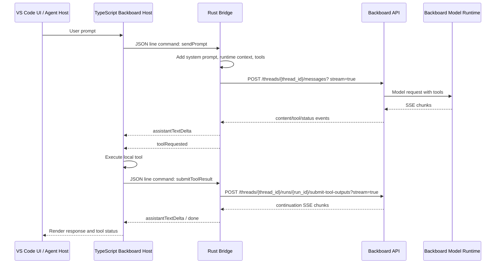

# Backboard Runtime Reference

This folder is a copied reference snapshot of the Backboard runtime files that wire
the VS Code host, Rust bridge, Backboard HTTP API, system prompt, and tool-call
loop together.

The copies are intentionally grouped by runtime responsibility so they can be
read without navigating the whole VS Code tree. Treat these files as reference
copies only. Edit the original source paths when changing product behavior.

## Folder Layout

```text
backboard-reference/
  AGENTS.md
  README.md
  docs/
    BACKBOARD_AGENT_WORKSPACE_FROM_ZED.md
    CREDENTIALS.md
    BACKBOARD_COPILOT_REWIRE_PLAN.md
    ENDPOINTS.md
    EXTENSION.md
    ONBOARDING_AND_SETTINGS.md
    SANDBOX_COPILOT_WIRING.md
    SIMPLE_BACKBOARD_REWIRE_CHECKLIST.md
    SSO.md
    TOOL_CALLS_AND_API.md
  source-copies/
    rust/
      Cargo.toml
      backboard_bridge/
        Cargo.toml
        src/
          main.rs
          backboard_runtime_system_prompt.md
      backboard/
        Cargo.toml
        src/
          backboard.rs
          endpoints/
            assistants.rs
            billing.rs
            client.rs
            config.rs
            documents.rs
            memories.rs
            mod.rs
            models.rs
            routes.rs
            stream.rs
            threads.rs
            tools.rs
            types.rs
    typescript/
      workbench-chat-setup/
        chatSetup.ts
        chatSetupRunner.ts
        chatSetupContributions.ts
        media/
          chatSetup.css
      extensions-backboard/
        package.json
        settings/
          extension.settings-and-onboarding.ts
        sso/
          extension.sso.ts
          package.json
        src/
          extension.ts
      agent-host/
        backboard/
          backboardAgent.ts
```

## Original Source Paths

These reference copies came from:

- `extensions/backboard/rust/Cargo.toml`
- `extensions/backboard/rust/crates/backboard_bridge/Cargo.toml`
- `extensions/backboard/rust/crates/backboard_bridge/src/main.rs`
- `extensions/backboard/rust/crates/backboard_bridge/src/backboard_runtime_system_prompt.md`
- `extensions/backboard/rust/crates/backboard/Cargo.toml`
- `extensions/backboard/rust/crates/backboard/src/backboard.rs`
- `extensions/backboard/rust/crates/backboard/src/endpoints/*.rs`
- `extensions/backboard/src/extension.ts`
- `extensions/backboard/package.json`
- `src/vs/platform/agentHost/node/backboard/backboardAgent.ts`

The isolated SSO reference under
`source-copies/typescript/extensions-backboard/sso/extension.sso.ts` is an
extracted copy of the OAuth-relevant blocks from `extensions/backboard/src/extension.ts`.

## Runtime Ownership

### Rust bridge

Reference copy: `source-copies/rust/backboard_bridge/src/main.rs`

The bridge is a long-running stdin/stdout JSON process. The TypeScript host
spawns it and sends one JSON request per line. The bridge responds with JSON
events, also one per line.

Important responsibilities:

- Defines the bridge protocol commands such as `initialize`, `listModels`,
  `listTools`, `runTool`, `sendPrompt`, `submitToolResult`, `cancel`, and API
  passthrough commands.
- Builds the final message payload sent to Backboard.
- Embeds the runtime system prompt using `include_str!("backboard_runtime_system_prompt.md")`.
- Appends runtime context to the prompt: workspace root, current mode, and
  available tool names.
- Provides tool definitions in OpenAI-style function-calling schema.
- Consumes Backboard Server-Sent Events and emits host-friendly events such as
  `assistantTextDelta`, `toolRequested`, `media`, `voice`, `usage`, `progress`,
  `error`, and `done`.
- Handles tool-output submission back to Backboard after the TypeScript host has
  executed local tools.

### Rust Backboard API client

Reference copies: `source-copies/rust/backboard/src/endpoints/*.rs`

The `backboard` Rust crate owns the HTTP client and endpoint wrappers.

Key files:

- `client.rs` creates `BackboardClient`, applies `X-API-Key`, builds URLs, and
  normalizes non-success HTTP responses.
- `config.rs` defines the production, development, and local base URLs and loads
  `~/.backboard_ide/config.json`.
- `routes.rs` centralizes endpoint path construction.
- `threads.rs` sends messages, streams message events, lists threads, creates
  assistant threads, and cancels runs.
- `tools.rs` submits tool outputs and streams the continuation response.
- `stream.rs` converts form payloads and parses SSE `data:` lines into JSON.
- `assistants.rs`, `documents.rs`, `memories.rs`, `models.rs`, and `billing.rs`
  wrap the rest of the Backboard API surface.
- `types.rs` defines request/response payload structs used by the bridge and
  API client.

### Standalone Backboard extension host

Reference copy: `source-copies/typescript/extensions-backboard/src/extension.ts`

This is the packaged Backboard extension host implementation. It owns the
webview panel, OAuth/API-key setup, settings, model/tool cache, and process
management for the Rust bridge.

Important responsibilities:

- Registers Backboard commands and the `backboard.panel` webview.
- Stores credentials and panel state under `~/.backboard_ide`.
- Spawns the Rust bridge binary from `extensions/backboard/bin` or the local
  Rust build output.
- Sends bridge requests such as `sendPrompt`, `listTools`, `listModels`,
  `runTool`, and API passthrough commands.
- Renders bridge events into the panel UI.
- Receives `toolRequested` events, executes local tools, and calls
  `submitToolResult`.

### Agent-host Backboard integration

Reference copy: `source-copies/typescript/agent-host/backboard/backboardAgent.ts`

This is the newer agent-host integration under `src/vs/platform/agentHost`.
It adapts the same Rust bridge into the common agent session protocol.

Important responsibilities:

- Implements the `IAgent` interface for the Backboard provider.
- Creates and restores Backboard sessions.
- Sends user prompts to the Rust bridge with model, mode, memory, web search,
  image generation, and MCP settings.
- Converts bridge events into session actions for the workbench UI.
- Executes most local workspace tools in TypeScript.
- Sends tool outputs back through the bridge for Backboard continuation.

## System Prompt

Reference copy:
`source-copies/rust/backboard_bridge/src/backboard_runtime_system_prompt.md`

The system prompt is not a TypeScript string. It is Markdown embedded into the
Rust bridge binary:

```rust
const BACKBOARD_SYSTEM_PROMPT: &str = include_str!("backboard_runtime_system_prompt.md");
```

At request time, the bridge wraps the prompt with runtime context and the user
request. The shape is:

```text
<embedded Backboard runtime system prompt>

## Runtime Context

- Target workspace root: <workspace>
- Current Backboard mode for this turn: <mode>
- Available tools for this turn: <tool names>

Treat relative file, grep, glob, shell, and edit tool paths as relative to the
target workspace root unless the user explicitly provides another path.

## User Request

<user content>
```

The API reference section inside the system prompt is documentation for the
model. The actual HTTP implementation is in the Rust API client.

## Tool-Call Flow



## Tool Definition vs Tool Execution

The Rust bridge defines the tool schema list, but not every tool is executed in
Rust.

Rust-executed compatibility tools:

- `web_search`
- `web_fetch`
- `computer` currently returns unsupported

TypeScript-executed local tools include:

- File reads and directory listings.
- `glob`, `grep`, and codebase search.
- File writes, edits, deletes, and directory creation.
- Shell and code execution.
- Helper tools such as todo, sleep, plan-mode compatibility, and persistence.

This split lets Rust focus on Backboard API/network streaming while the VS Code
host performs workspace operations with local filesystem and terminal access.

## API Flow

Primary request path:

1. TypeScript sends bridge command `sendPrompt`.
2. Rust creates a `SendMessageRequest`.
3. Rust calls `BackboardClient::send_message_stream`.
4. `threads.rs` posts form data to the Backboard thread message route with
   `stream=true`.
5. `stream.rs` parses SSE `data:` payloads into JSON chunks.
6. `main.rs` maps chunks to bridge events.

Tool-output continuation path:

1. Backboard returns a requires-action/tool-call chunk.
2. Rust emits `toolRequested`.
3. TypeScript executes the local tool call.
4. TypeScript sends bridge command `submitToolResult`.
5. Rust calls `BackboardClient::submit_tool_outputs_stream`.
6. `tools.rs` posts outputs to
   `/threads/{thread_id}/runs/{run_id}/submit-tool-outputs?stream=true`.
7. Rust streams the continuation response back to TypeScript.

## Useful Search Targets

Use these strings to jump to the important implementation points:

- `BACKBOARD_SYSTEM_PROMPT`
- `augment_prompt`
- `tool_definitions`
- `all_tool_definitions`
- `send_prompt`
- `submit_tool_result`
- `consume_stream`
- `emit_tool_requested_events`
- `BackboardBridgeProcess`
- `executeBackboardTool`
- `BackboardBridge`
- `callApi`
- `send_message_stream`
- `submit_tool_outputs_stream`
- `message_form`
- `sse_json_stream`

## Deep-Dive Docs

- `docs/BACKBOARD_AGENT_WORKSPACE_FROM_ZED.md` maps Zed's Backboard Agent
  Workspace architecture into the VS Code/Copilot-style workbench. Use it for
  the new page with a center 3-by-N agent grid and a right-panel Backboard
  composer/detail surface. Editor context comes later as actions and context,
  not as the center of the first page.
- `docs/CREDENTIALS.md` documents exactly where the API key is stored, the JSON
  shape, SSO-derived key precedence, manual key storage, environment scoping,
  file permissions, and how TypeScript/Rust read credentials.
- `docs/ENDPOINTS.md` documents the Backboard HTTP API surface implemented by
  the copied Rust client: base URLs, auth, message streaming, assistants,
  threads, documents, memories, models, billing, and bridge-command mappings.
- `docs/EXTENSION.md` documents the Backboard VS Code extension itself:
  package manifest, activation events, commands, view contributions, settings,
  webview lifecycle, bridge process lifecycle, panel state, model/tool caches,
  and how it connects the UI to the Rust bridge.
- `docs/SSO.md` walks through Backboard SSO/OAuth in depth: command entry
  points, PKCE, local callback server, token exchange, config persistence,
  auth context updates, bridge restart, fallback callback handling, and failure
  modes.
- `docs/TOOL_CALLS_AND_API.md` documents the bridge JSON protocol, model tool
  schemas, tool-call event payloads, local tool execution ownership, tool-output
  submission, API passthrough commands, and concrete example payloads.

## Notes For Future Changes

- Change product behavior in the original source files, not in these copied
  reference files.
- If tool schemas change, check both the Rust schema list and the TypeScript
  execution switch.
- If prompt behavior changes, update the Markdown prompt file and verify the
  `augment_prompt` wrapper still gives the model the needed runtime context.
- If API paths change, update `routes.rs` first, then endpoint wrappers and the
  system prompt API reference.
- If a tool is moved from TypeScript to Rust or vice versa, update the schema,
  execution switch, and user-facing tool status messages together.
