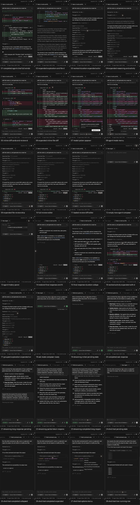

# Cursor right agent panel reference

Captured from the live Cursor desktop app on macOS on 2026-08-20. The Cursor window was 1229 × 768 px and the right agent panel was approximately 405 px wide.

> **Implementation scope:** the accompanying prompt targets only the scrollable chat transcript. Tabs/header, composer, menus, changed-files review dock, and central review editor are visible for context and must remain unchanged.

Each state is available as:

- a full-window screenshot that preserves editor and workbench context;
- a 405 × 768 panel-only crop under `crops/`;
- the contact sheet below for fast comparison.

## Capture index

| # | State | Full window | Panel crop |
|---:|---|---|---|
| 01 | Completed coding-agent chat with diffs, final answer, review dock, and composer | [full](01-completed-agent-chat-full-window.png) | [panel](crops/01-completed-agent-chat-full-window-panel.png) |
| 02 | Expanded exploration and inline file diffs | [full](02-expanded-exploration-and-file-diffs.png) | [panel](crops/02-expanded-exploration-and-file-diffs-panel.png) |
| 03 | `Worked for…` disclosure and expanded activity timeline | [full](03-worked-duration-expanded-activity.png) | [panel](crops/03-worked-duration-expanded-activity-panel.png) |
| 04 | Expanded reasoning plus expanded activity timeline | [full](04-expanded-reasoning-and-activity.png) | [panel](crops/04-expanded-reasoning-and-activity-panel.png) |
| 05 | Compact inline diff cards and collapsed file-review dock | [full](05-inline-diff-cards-and-review-strip.png) | [panel](crops/05-inline-diff-cards-and-review-strip-panel.png) |
| 06 | Expanded inline file diff | [full](06-expanded-inline-file-diff.png) | [panel](crops/06-expanded-inline-file-diff-panel.png) |
| 07 | Model picker / upgrade popover | [full](07-model-picker-popover.png) | [panel](crops/07-model-picker-popover-panel.png) |
| 08 | Agent mode menu: Agent, Plan, Debug, Multitask, Ask | [full](08-agent-mode-menu.png) | [panel](crops/08-agent-mode-menu-panel.png) |
| 09 | Expanded changed-files review dock | [full](09-expanded-file-review-strip.png) | [panel](crops/09-expanded-file-review-strip-panel.png) |
| 10 | Review editor opening/loading state | [full](10-full-review-editor.png) | [panel](crops/10-full-review-editor-panel.png) |
| 11 | Loaded side-by-side review diff editor | [full](11-loaded-review-diff-editor.png) | [panel](crops/11-loaded-review-diff-editor-panel.png) |
| 12 | Empty new-agent state and top-positioned composer | [full](12-empty-new-agent-composer.png) | [panel](crops/12-empty-new-agent-composer-panel.png) |
| 13 | Agent history/search popover | [full](13-agent-history-panel.png) | [panel](crops/13-agent-history-panel-panel.png) |
| 14 | Restored final answer with expanded per-file review rows | [full](14-restored-final-response-and-file-review.png) | [panel](crops/14-restored-final-response-and-file-review-panel.png) |
| 15 | Completed answer with duration collapsed | [full](15-final-response-duration-collapsed.png) | [panel](crops/15-final-response-duration-collapsed-panel.png) |
| 16 | Worked activity expanded alongside diffs | [full](16-worked-activity-expanded-with-diffs.png) | [panel](crops/16-worked-activity-expanded-with-diffs-panel.png) |
| 17 | Grouped exploration expanded with file review visible | [full](17-grouped-exploration-expanded-with-review.png) | [panel](crops/17-grouped-exploration-expanded-with-review-panel.png) |
| 18 | Ask-mode composer populated and ready to send | [full](18-ask-mode-composer-ready.png) | [panel](crops/18-ask-mode-composer-ready-panel.png) |
| 19 | Initial streaming state: sticky request, `Planning next moves`, stop control | [full](19-streaming-initial-pending-state.png) | [panel](crops/19-streaming-initial-pending-state-panel.png) |
| 20 | Completed short Ask response | [full](20-completed-ask-response.png) | [panel](crops/20-completed-ask-response-panel.png) |
| 21 | Pending state for a longer streamed response | [full](21-streaming-long-response-pending.png) | [panel](crops/21-streaming-long-response-pending-panel.png) |
| 22 | Genuine partial-token stream ending mid-sentence | [full](22-streaming-partial-token-response.png) | [panel](crops/22-streaming-partial-token-response-panel.png) |
| 23 | Same long response after completion | [full](23-streaming-completed-long-response.png) | [panel](crops/23-streaming-completed-long-response-panel.png) |
| 24 | Shell tool pending / planning state | [full](24-shell-tool-pending-state.png) | [panel](crops/24-shell-tool-pending-state-panel.png) |
| 25 | Completed shell tool in compact form | [full](25-shell-tool-completed-collapsed.png) | [panel](crops/25-shell-tool-completed-collapsed-panel.png) |
| 26 | Expanded shell command and output | [full](26-shell-tool-completed-expanded.png) | [panel](crops/26-shell-tool-completed-expanded-panel.png) |
| 27 | Shell auto-run and sandbox options menu | [full](27-shell-tool-options-menu.png) | [panel](crops/27-shell-tool-options-menu-panel.png) |
| 28 | Multi-line shell output and final response | [full](28-shell-tool-live-running-row.png) | [panel](crops/28-shell-tool-live-running-row-panel.png) |

## High-value comparisons

- Streaming lifecycle: 18 → 19 → 22 → 23.
- Coding-agent lifecycle: 03 → 04 → 05 → 06 → 09 → 11.
- Shell tool disclosure: 24 → 25 → 26 → 27 → 28.
- Empty/history/navigation: 12 → 13 → 14.

The implementation brief derived from these captures is in [IMPLEMENTATION_PROMPT.md](IMPLEMENTATION_PROMPT.md).
